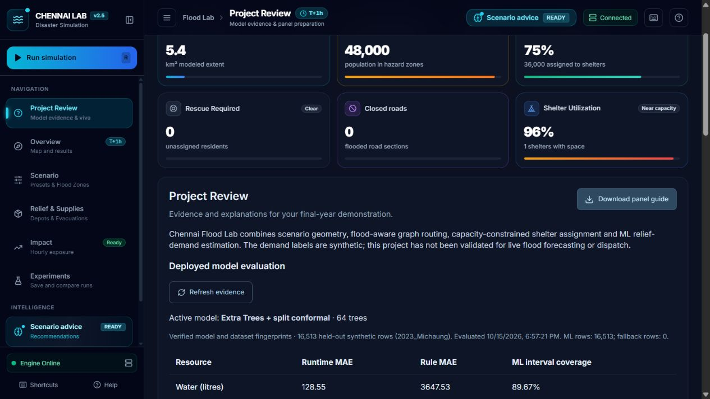

# Project repair and panel-readiness verification — 15 October 2026

Existing uncommitted implementation and model work were preserved. This pass inspected the existing modules and added evaluation/panel preparation, repaired advice consistency and experiment recording, and tested the final application.

## Changes in this pass

- Added Project Review: deployed runtime evaluation, rule baseline, conformal coverage, current-run timing and ML/rule counts, 15 searchable viva questions, downloadable Markdown guide and demo sequence.
- Added `GET /api/model/evaluation`. Reports are withheld if model/dataset fingerprints differ, the saved report is unavailable, or another predictor is active. Evaluation runs explicitly from the CLI; HTTP requests do not train models or run the full evaluator.
- Added `--save` to the standard-library runtime evaluator and generated the bundled runtime report.
- Advice and its wards/airlift/broadcast subviews now share a cached, locked, completed simulation snapshot. Requests can carry a simulation ID; mismatches return 409. Before a run, advice returns 409 instead of generating an unrelated default alert.
- Frontend advice uses the result attached to the completed run and identifies the final snapshot hour. A failed refresh clears advice and reports the connection/scenario issue.
- Dry and shallow scenarios use appropriate severity. Dry scenarios do not generate emergency-warning bulletins. Sample bulletins carry explicit simulation labels. Zero-incident preventive directives are omitted.
- Airlift analysis reports `no_safe_drop_zone` when every modeled candidate is inundated; it no longer selects a flooded elevated fallback site.
- The experiment recorder stays mounted while hidden, so runs completed in other views are saved. Navigating away and back no longer re-adds a deleted current experiment solely through remounting.
- Dashboard-level run actions reject unfinished drawing, matching the controls' drawing constraint.
- Startup checks backend readiness, rejects an unrelated frontend occupying port 3000, uses explicit IPv4 loopback checks and basic HTTP parsing compatible with Windows PowerShell.
- Added the submission/panel guide in `docs/PANEL_PREPARATION.md` and updated README.

## Verification

| Boundary | Result | Evidence |
|---|---|---|
| Backend unit/API regressions | Passed | `python -m pytest backend/tests -q`: **81 passed** |
| Strict live API integration | Passed | `python -m pytest e2e -q --strict-live`: **95 passed** |
| Production frontend | Passed | `npm run build`: compiled, linted, type-checked and generated static pages |
| Windows launcher | Passed | `powershell -NoProfile -ExecutionPolicy Bypass -File .\start_project.ps1`: exit 0 against running services |
| Browser → proxy → engine → result | Passed | Velachery and T. Nagar each produced seven snapshots with map overlays and metrics |
| Manual allocation | Passed | Recorded 5,000 litres and 50 kits; UI available stock fell by corresponding amounts |
| Cross-view experiment recording | Passed | Ran Velachery and T. Nagar before opening Experiments; both rows appeared with distinct conditions and results |
| Comparison download | Passed | Downloaded CSV and inspected header and both scenario rows |
| Review/evaluation rendering | Passed | Active 64-tree model, 16,513 synthetic held-out rows and runtime metric table rendered |
| Panel-guide download | Passed | Downloaded Markdown and inspected its title and grounded Q&A |
| Viva search | Passed | Searching `leakage` returned the matching question |
| Browser console | Passed in checked flows | No captured error-level logs |

The five new backend tests cover dry advice, shared advisory subviews, stale simulation IDs, all-flooded airlift sites, evaluation provenance and pre-run advice. Tests emit an existing Starlette/httpx deprecation warning.

## Reproduced demand evaluation

Command: `python -m backend.ml_pipeline.evaluate_portable_model --save`.
55,000 synthetic rows total; 28,865 training, 9,622 calibration, 16,513 held-out synthetic 2023-event evaluation. The deployed evaluator used ML for all held-out rows and no rule fallbacks.

| Resource | Runtime MAE | Rule-baseline MAE | Interval coverage on ML rows |
|---|---:|---:|---:|
| Water (litres) | 128.55 | 3,647.53 | 89.67% |
| Food (rations) | 98.13 | 1,843.65 | 90.21% |
| Medicine (kits) | 13.08 | 91.54 | 90.23% |

These are synthetic demand-label errors, not observed flood forecasting accuracy. Some interactive scenarios legitimately fall outside training ranges and use planning rules; the review shows those counts explicitly.

## Scope and remaining limits

Browser verification was a focused smoke check; every UI action has not been exhaustively automated. Geometry, populations, facility data and demand labels remain modeled. There is one shared in-memory active scenario, no persistent per-user backend, no finite rescue fleet/scheduling and no real notification/dispatch integration. Street tiles need an internet connection. The app is suitable for demonstrating the implemented academic workflow; real emergency deployment and scientific validation require additional data and work.

Dashboard running at http://localhost:3000; API at http://127.0.0.1:8000. Restart with `start_project.bat`.

